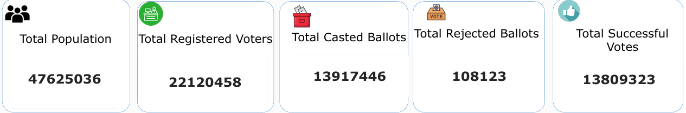
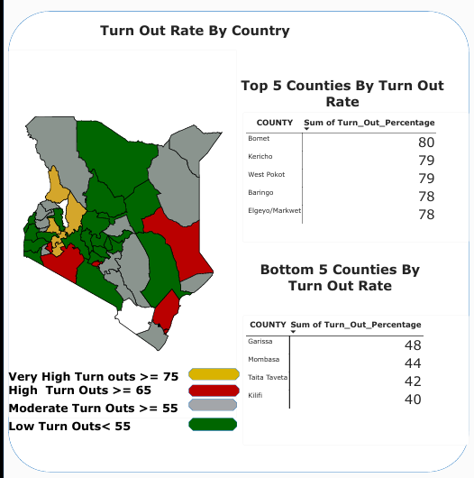
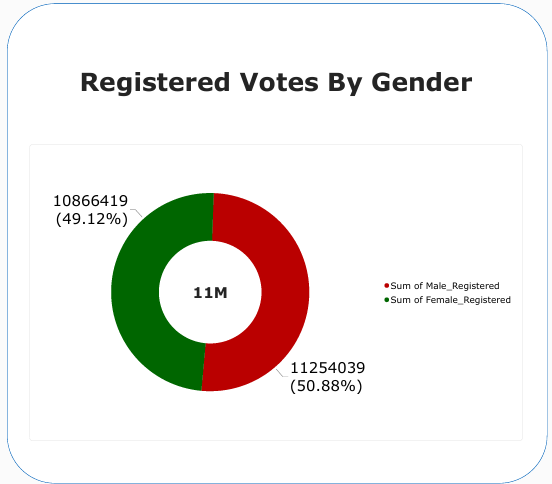
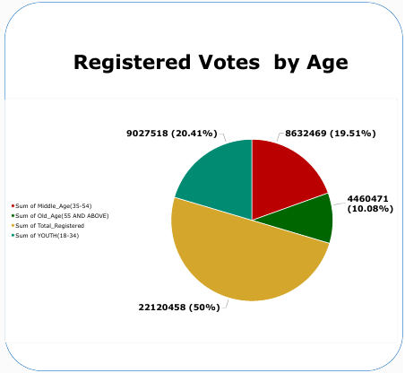
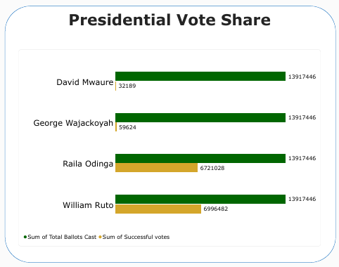
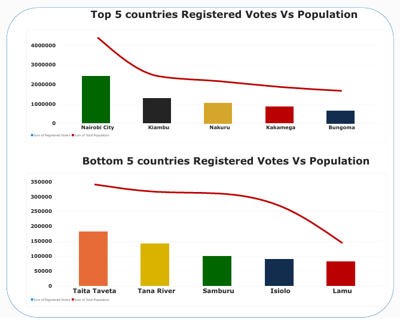
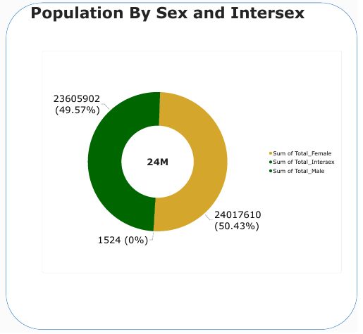

# Kenya 2022 General Election Analysis Dashboard | Power BI

**Turning Election Data into Participation Insights**

An interactive business intelligence project analyzing voter registration, turnout, demographics, and presidential results in Kenya's 9 August 2022 General Election, to understand who took part and where participation was strongest or weakest.

## 📊 Dashboard Preview


*Power BI dashboard providing an overview of national election KPIs, county turnout, registration by gender and age, presidential vote share, and registration against population.*

## 📌 Project Overview

Kenya holds general elections every five years. The last was on 9 August 2022, and the next is due in August 2027. Over the past four and a half years, many Kenyans have felt economic, social, and nutritional pressure, and that has made me ask who actually shaped the outcome of the 2022 vote.

This project uses publicly available electoral data to answer that question. It looks at who registered, who turned out, and where, across three dimensions:

* **Gender:** Which gender registered in greater numbers, and how did that registration compare with actual turnout?
* **Age:** Which age groups made up the register, and how did their share of registered voters compare with their share of voters who turned out?
* **Location:** Which counties had the highest turnout rate relative to their registered voters, and which had the lowest?

The IEBC reported 22,120,458 registered voters for 2022. Women made up 49.12% of the register and men 50.88%. National turnout was recorded at 64.77%. These headline numbers hide large differences between groups and counties, and the analysis and visualisations in this project aim to bring those differences out.

The goal is not to assign blame. It is to understand who took part in 2022 and where participation was strongest or weakest, so that registration and turnout in 2027 can be better informed.


## 🎯 Problem Statement

The central question guiding this project is:

> **Who registered to vote, who turned out to vote, and how did participation vary across gender, age groups, and counties in Kenya's 2022 General Election?**

The project explores the following questions:

* Who registered to vote, and how was the register split by gender and age group?
* How did turnout vary across counties?
* Which counties had the highest and lowest turnout rates?
* How did the presidential candidates share the valid votes?
* How do registered voters compare with county population?
* How is the population split by sex?

## 🗂️ Data Source

The data used in this project was sourced primarily from the Independent Electoral and Boundaries Commission (IEBC), the Kenya National Bureau of Statistics (KNBS), and the official Kenya National Census publications.

**1. Registered Voters by Gender and County**
Source: Kenya National Bureau of Statistics (KNBS), Economic Survey 2023, Table 17.21, "Registered Voters, 2021 and 2022." The original data source is the Independent Electoral and Boundaries Commission (IEBC). The figures are provisional and reflect the position as at 31 December 2022.

**2. Registered Voters by Age Group**
Source: Independent Electoral and Boundaries Commission (IEBC), Post-Election Evaluation Report for the 9 August 2022 General Election, Annex V, "Voter Registration Age Group Distribution Per County." This annex provides voter registration counts by age group for individual counties, supporting county-level demographic analysis.

**3. Population and Census Data**
Source: Kenya National Bureau of Statistics (KNBS), official Kenya National Census publications and census data page. These data were used to obtain population figures for comparison with voter registration statistics and to examine population distributions across counties and demographic groups.

Together, these sources provided the foundation for analyzing voter registration, demographic distributions, county-level patterns, and election turnout in Kenya's 2022 General Election.

## 🛠️ Tools and Technologies

* **Microsoft Power BI:** Data modelling and interactive dashboard development.
* **Power Query:** Loading, shaping, and transforming the data before modelling.
* **DAX:** Calculated measures such as turnout rate and registration shares by gender and age group.
* **Microsoft Excel:** Consolidating the datasets into one workbook with five worksheets.

## 🔧 Data Transformation

The data came from several sources and was consolidated into one Excel workbook with five worksheets. Each worksheet holds one dataset, and the county name and county code are the keys that link them. The workbook was then loaded into Power BI for modelling and visualisation.

| Worksheet | Columns | Purpose |
| --- | --- | --- |
| Counties | County_Code, County | Reference list of the 47 counties and their codes |
| Registered Voters by Gender | County_Code, County, Male_Registered, Female_Registered, Total_Registered | Gender split of the register in each county |
| Registered Voters by Age | County_Code, County, Youth (18-34), Middle_Age (35-54), Old_Age (55+), Total_Registered | Age-group split of the register in each county |
| Presidential Results | Candidate vote columns (including George Wajackoyah, David Mwaure, William Ruto, Raila Odinga), Total_Votes, Total_Registered, Turn_Out_Rate | Votes cast per county and the turnout rate |
| Population by County | County_Code, County, Total_Male, Total_Female, Total_Intersex, Total_Population | Census population per county |

**How the data was prepared**

1. Collected each dataset separately from its official source (see Data Source).
2. Placed each dataset on its own worksheet in a single workbook, keeping the original figures unchanged.
3. Standardised the keys, using the same county names and codes across all worksheets so they can be matched.
4. Calculated turnout rate as Total_Votes ÷ Total_Registered × 100 for each county.
5. Loaded the workbook into Power BI, linking the worksheets through County_Code to build a data model.

**Why this structure:** Keeping each dataset on its own sheet keeps the source clear and makes errors easier to trace. Because every sheet carries County_Code, the sheets can be joined for the gender, age, and location comparisons. Power BI then turns that joined model into interactive visuals.

## 📈 Key Performance Indicators

| KPI | Value |
| --- | ---: |
| Total Population | 47,625,036 |
| Total Registered Voters | 22,120,458 |
| Total Cast Ballots | 13,917,446 |
| Total Rejected Ballots | 108,123 |
| Total Successful (Valid) Votes | 13,809,323 |



Of Kenya's roughly 47.6 million people, 22.1 million (about 46.4%) were registered to vote. Of those registered, 13.9 million cast ballots, a turnout of about 62.9%. Rejected ballots numbered 108,123, only 0.78% of ballots cast, leaving 13.8 million valid votes (99.22% of ballots cast).

The 2022 election was administratively clean, with very few spoilt ballots, but participation was the weak point. The biggest opportunities for improvement lie in registering more eligible citizens and getting registered voters to turn out.

*Note: The introduction cites the IEBC-recorded national turnout of 64.77%, while the dashboard figures (ballots cast ÷ registered voters) give about 62.9%. The difference reflects the data sources and calculation method used.*

## 🔍 Dashboard Features

### 1. National Snapshot

Summarizes the population, registered voters, ballots cast, rejected ballots, and valid votes.

### 2. Turn Out Rate by County

A map and top/bottom-5 tables showing where participation was strongest and weakest.

Voter turnout in 2022 varied sharply across Kenya's counties, ranging from 40% to 80%. The highest turnout came from Bomet (80%), followed by Kericho and West Pokot (79% each), and Baringo and Elgeyo/Marakwet (78% each). Four of these five are Rift Valley counties, pointing to a strong regional concentration of high participation.

At the other end, Kilifi (40%), Taita Taveta (42%), Mombasa (44%) and Garissa (48%) recorded the lowest turnout. Three of the four are in the Coast region, with Garissa in the north-east, so low participation clusters there.

* **Wide gap:** The spread between the top county (Bomet, 80%) and the bottom (Kilifi, 40%) is 40 percentage points, showing very uneven civic engagement across the country.
* **Regional pattern:** High turnout is concentrated in the Rift Valley, while the Coast and parts of the north-east and east lag behind.
* **Map classification:** A large share of the map falls in the low and moderate bands (green and grey), with only a few counties reaching the very high (75% and above) category.



### 3. Registered Voters by Gender

Voter registration in 2022 was almost evenly split between men and women. Male voters numbered 11,254,039 (50.88%), while female voters numbered 10,866,419 (49.12%). Together they make up the 22.1 million registered voters, matching the figure in the KPI card.

* The gap between the two groups is only 1.76 percentage points, showing that registration is fairly balanced across genders.
* Men outnumber women by about 387,620 registered voters, a modest difference given the size of the electorate.
* Women's share is close to half, which suggests no major gender barrier at the registration stage.



### 4. Registered Voters by Age

Youth (18-34) make up the largest age group at 9,027,518 registered voters (20.41%), followed by middle-aged voters (35-54) at 8,632,469 (19.51%). The old-age group (55 and above) is the smallest at roughly 10%, with its label truncated in the chart.

Young voters dominate registration, while older voters are the smallest group. For a cleaner insight, remove "Total Registered" from the chart so the three age groups show their true shares of the electorate (youth about 41%, middle-aged about 39%, old about 20%).



### 5. Presidential Vote Share

William Ruto led the 2022 presidential race with 6,996,482 votes, narrowly ahead of Raila Odinga with 6,721,028. The two frontrunners together took almost all the votes, while George Wajackoyah (59,624) and David Mwaure (32,189) trailed far behind.

The election was effectively decided between two candidates, with Ruto edging Odinga by a slim margin while the other contenders had negligible impact.



### 6. Registered Voters vs Population

Registration tracks county size. Nairobi City leads with about 2.4M registered voters, followed by Kiambu, Nakuru, Kakamega and Bungoma. At the bottom are Taita Taveta (about 180,000), Tana River, Samburu, Isiolo and Lamu (about 80,000).

* The most populous counties dominate registration, while sparsely populated ones sit at the bottom.
* The population line sits well above the bars in every county, so many residents are not registered, partly because of those under 18.
* Raw registration numbers mostly mirror population. A registration rate (registered voters as a percentage of population) would show more clearly which counties are over- or under-registered.



### 7. Population by Sex and Intersex

Kenya's population is almost evenly split by sex. Females number 24,017,610 (50.43%) and males 23,605,902 (49.57%), with 1,524 intersex people (under 0.01%). Together they total about 47.6 million, matching the KPI card.

* Women outnumber men by about 411,708, a gap of under 1 percentage point.
* Women are the larger group in the population (50.43%) but the smaller group among registered voters (49.12%), which suggests a small gender gap in registration.
* **Intersex population:** At 1,524 people, this group is too small to show on the chart, though it is important to count for inclusion.



### 8. Key Insights and Filters

A summary panel, plus slicers for county, candidate, and turnout grouping.

## 🧠 Analytical Approach

The project uses summary KPIs, comparative visualizations, and interactive filters to explore participation in the 2022 election.

The analysis involves:

1. Reviewing the national snapshot of population, registration, ballots cast, and valid votes.
2. Comparing turnout rates across counties, including the top and bottom five.
3. Examining the register by gender and by age group.
4. Comparing presidential vote share across candidates.
5. Comparing registered voters with county population.
6. Comparing population by sex with registration by gender.

## 💡 Key Insights

* **Participation was the weak point:** The election was administratively clean, with only 0.78% of ballots rejected, but registration and turnout both fell short.
* **Turnout was uneven:** Turnout ranged from 40% to 80% across counties, with high turnout concentrated in the Rift Valley and low turnout at the Coast and in the north-east.
* **Registration was gender-balanced:** Men made up 50.88% of the register and women 49.12%.
* **Youth lead the register:** Voters aged 18-34 are the largest age group.
* **A two-candidate contest:** Ruto and Odinga took almost all valid votes, with Ruto ahead by a slim margin.
* **Registration mirrors population:** The most populous counties dominate registration.

Together, these views show that participation was uneven across the country and give a baseline for understanding who may shape the 2027 election.

## 🚀 Recommendations for Further Analysis

1. **Target low-turnout counties:** Voter education and mobilization efforts would be most valuable in the Coast and north-east counties with the lowest turnout.
2. **Expand registration:** Focus on registering more eligible citizens, especially eligible youth.
3. **Compute a registration rate:** Add registered voters as a percentage of population to show which counties are over- or under-registered.
4. **Clean the age chart:** Remove "Total Registered" from the age chart so the three age groups show their true shares of the electorate.
5. **Compare turnout by gender and age:** Extend the analysis to compare each group's share of registered voters with its share of voters who turned out.
6. **Reconcile turnout figures:** Confirm why the IEBC-recorded turnout (64.77%) differs from the dashboard calculation (about 62.9%).

## 🧰 Skills Demonstrated

| Skill | How it was applied in this project |
| --- | --- |
| Data collection | Gathered data from official sources, including the IEBC, KNBS, and the national census, covering registration, results, and population. |
| Worksheet consolidation | Combined datasets from different sources into one Excel workbook with five worksheets, linked by county code. |
| Data cleaning | Standardised county names and codes, and corrected inconsistencies so the datasets could be matched. |
| Handling null values | Identified missing or blank entries and dealt with them so they would not distort totals or turnout rates. |
| Power Query | Used Power Query in Power BI to load, shape, and transform the data before modelling. |
| DAX | Wrote calculated measures, such as turnout rate and registration shares by gender and age group. |
| Power BI | Built a data model and interactive visuals to compare participation across gender, age, and county. |

## 📁 Project Structure

```text
KENYA_2022_ELECTIONS_ANALYSIS/
├── README.md
├── Images/
│   ├── 2022ElectionDashboard.jpg
│   ├── Kenyamappedflag.jfif
│   ├── Kenyas2022election_KPI.PNG
│   ├── Turn_Out_Rate_BY_County.PNG
│   ├── Registered_Voters_BY_Gender.PNG
│   ├── Registered_Voters_BY_Age.PNG
│   ├── Presidential_Vote_Share.PNG
│   ├── Registered_Voters_VS_Population.PNG
│   └── Population_BY_Sex_Intersex.PNG
├── <your Excel workbook>.xlsx
└── <your Power BI file>.pbix
```

*The structure above reflects the project files. Keep the documentation aligned with the actual contents of the repository.*

## 👩‍💻 Author

**Beatrice Wambui**

Data Analyst | Turning Data Into Actionable Insights

* [GitHub Profile](https://github.com/beatricewambui4)

## Conclusion

The Kenya 2022 General Election Analysis Dashboard demonstrates how Power BI can consolidate registration, results, and census data into an interactive report for exploring who registered, who turned out, and how participation varied by gender, age, and county.

By combining visual analysis with a clear central question, this project provides a baseline for understanding participation in 2022 and for informing registration and turnout efforts ahead of the 2027 election.
